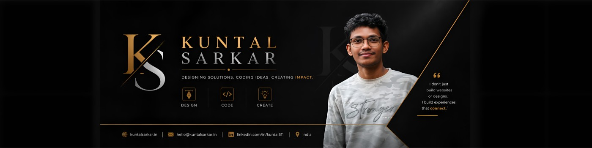

# Kuntal Sarkar — Portfolio Data

> Consolidated profile data for building the portfolio site.
> Sources merged: **LinkedIn** (saved page, Oct 2026), **kuntalsarkar.in** (old portfolio), **github.com/kuntal811**.
> Where sources conflict, the **latest (LinkedIn)** data wins. Stale entries are listed at the bottom so they are not reused.

  

  

---

## 1. Basics

| Field | Value |
|---|---|
| Name | **Kuntal Sarkar** (He/Him) |
| Headline | **Software Engineer \| AI Systems \| SaaS Platforms \| Laravel \| React** |
| Current role | Software Engineer @ **Sarcon** (Sarcon Technology Pvt Ltd) |
| Experience | **4+ years** professional (Aug 2021 → present; full-time since Jul 2022) |
| Location | Malda, West Bengal, India |
| Languages spoken | Bengali, English, Hindi |
| Date of birth | 22-11-1998 *(public on old site — decide if you want it on the new one)* |
| LinkedIn stats | 487 followers · 464 connections |

### Tagline / short bio

Software Engineer building AI-powered platforms, agentic workflow systems, and large-scale event technology at a SaaS company serving enterprise clients (Amazon, Microsoft, IBM, MCI, George P. Johnson).

### About (long)

Built AI-powered platforms, agentic workflow systems, and large-scale event technology at a SaaS company serving enterprise clients. Work spans production agentic AI (Claude API, tool routing, memory, multi-step reasoning), computer-vision check-in, performance engineering for 10,000+ attendee events, virtual 3D event experiences, and payments infrastructure.

### Top skills (LinkedIn)

AI Agents • Multi-agent Systems • SaaS Development • Laravel • React.js

---

## 2. Contact & Links

| Channel | Value |
|---|---|
| Email | hello@kuntalsarkar.in |
| Phone / WhatsApp | +91 81167 63585 *(public on old site)* |
| Website | https://kuntalsarkar.in |
| LinkedIn | https://www.linkedin.com/in/kuntal811 |
| GitHub | https://github.com/kuntal811 |
| Twitter / X | https://twitter.com/kuntal811 |
| Facebook | https://facebook.com/kuntal811 |
| Instagram | https://instagram.com/kuntal_adi |

---

## 3. Experience

### Sarcon — *4 yrs 11 mos total*
Event-tech SaaS (in-person, hybrid & virtual events, event apps, registration, on-site check-in). Clients: Amazon, Microsoft, IBM, MCI, George P. Johnson.

**Software Engineer** · Full-time · *Jul 2022 – Present*
Skills: Laravel, Multi-agent Systems, AI Agents, React.js, PostgreSQL, Redis, Python, Claude API, …

- **Agentic AI Operations Platform** — architected a production system with **117+ tools**, conversation memory, vector-based tool routing, and multi-step reasoning (Claude API, Laravel, PostgreSQL, Redis). Includes an observation loop that self-corrects and domain-aware tools that block destructive actions; reasons across speakers, sessions, registrations and badges in real time. Part of Sarcon's "AI Event OS" / *10-minute AI Event Manager* vision — event setup that took weeks now happens in minutes through conversation.
- **AI Badge Design System** — automated badge creation workflows, cutting delivery from **2 weeks → under 2 hours** (Claude API, Laravel, React.js).
- **Face Recognition Check-In** — cut attendee onboarding from **90 s → under 5 s** (sub-1-second recognition) using Python and computer vision; works with masks, sunglasses and low light; touchless entry, zone/session tracking, meal & giveaway monitoring, anti-ticket-fraud.
- **Performance Optimization** — reduced page load from **4.2 s → 1.1 s** for events with **10,000+ attendees** via Redis caching and query optimization.
- **Virtual Event Ecosystem** — 3D booths, networking and conference tools (React.js, Three.js, WebRTC).
- **Payments & Pricing Framework** — multi-provider payment integrations, pricing engines and coupon systems.

**Software Developer Intern** · Internship · *Dec 2021 – Jun 2022 (7 mos)*
Skills: HTML5, Laravel, …

### Code Uplers — Full Stack Developer
Freelance · *Aug 2021 – Dec 2021 (5 mos)* · Malda, West Bengal
Skills: HTML5, React.js

### Shining Tomorrow Foundation — Web Developer Intern
Internship · *Jan 2021 – Mar 2021 (3 mos)* · Delhi, India
- Built a multi-type quiz portal.
- Received the **SHINER Award** (`assets/images/shiner-award.jpg`).

---

## 4. Education

| Degree | Institution | Years |
|---|---|---|
| Master of Computer Applications (MCA) | Pondicherry University, Puducherry | 2020 – 2022 |
| B.Sc. Computer Science | Malda College, Malda | 2017 – 2020 |
| Higher Secondary | A.C. Institution, Malda | 2015 – 2017 |

---

## 5. Skills (merged)

**AI / LLM:** AI Agents, Multi-agent Systems, Agentic workflows, Claude API, Tool routing (vector-based), Conversation memory, Computer Vision / Face Recognition

**Backend:** PHP, Laravel, CodeIgniter, Python, Java, C, C++, REST APIs, Payment integrations

**Frontend:** React.js, JavaScript, jQuery, HTML5, CSS3, Bootstrap, Three.js, WebRTC

**Mobile:** Flutter / Dart, React Native, Kotlin (Flutter plugin)

**Data / Infra:** PostgreSQL, MySQL / SQL, Redis, Linux, Git, GitHub

**Design:** Figma

---

## 6. Achievements & Certifications

- **SHINER Award** — Shining Tomorrow Foundation (2021)
- **JavaScript Algorithms and Data Structures** — freeCodeCamp, Jan 2021
- **Java Programming** — Udemy, Jan 2021 (Credential ID `UC-ba5d5933-8279-401f-961a-e28aacc4a381`)
- *+2 more certifications on LinkedIn (not visible in saved page — fill in)*

---

## 7. Personal / Open-Source Projects

| Project | Description | Stack | Links |
|---|---|---|---|
| **Downtime Alert** | Monitors website uptime; alerts when site goes down and before SSL / domain expiry. | JavaScript | [repo](https://github.com/kuntal811/downtimeAlert) · [live](https://downtime-alert.web.app/) |
| **flutter_papertrail_alt** | Flutter package for advanced logging & real-time monitoring via Papertrail. Published on pub.dev. | Kotlin, Flutter | [repo](https://github.com/kuntal811/flutter_papertrail_alt) · [pub.dev](https://pub.dev/packages/flutter_papertrail_alt) |
| **Easy Resume** | Android app to create good-looking resumes. | React Native | [repo](https://github.com/kuntal811/Easy-Resume) |
| **Automatic Attendance (Face Recognition)** | Attendance from photo/video using face recognition. Final-year B.Sc. project. | Python, Eel, HTML, CSS | [repo](https://github.com/kuntal811/automatic-attendance-using-face-recognition) |
| **KS Meet** | Video chat website with screen sharing. | HTML, CSS, JS, PeerJS | [repo](https://github.com/kuntal811/KSMeet-Video-Chat) |
| **PHP MVC Framework** | Custom lightweight MVC framework in PHP. | PHP | [repo](https://github.com/kuntal811/PHP-MVC-Framework) |
| **EasyCompress** | Photo compressor — upload and compress with a single slider. | PHP | [repo](https://github.com/kuntal811/easycompress) |
| **News24** | News app using NewsAPI. | Flutter / Dart | [repo](https://github.com/kuntal811/news24) |
| **Upload-File-To-Drive** | Upload files to Google Drive via Google API PHP client. | PHP | [repo](https://github.com/kuntal811/Upload-File-To-Drive) |

> Project icons: `assets/images/project-*.png`

---

## 8. Media / Highlights (LinkedIn activity)

- Demo post: Sarcon's agentic AI handling event setup through conversation (speaker profile updates, conditional registration fields, badge editing). Building toward the *10-minute AI Event Manager*.
- Face Check-in launch: recognition in < 1 s, works with masks/sunglasses/low light.
- Sarcon event case studies: World Financial Innovation Series (Tradepass), Avalon Consulting "Sun Tzu" finale, MI All-Stars Summit, Middle East Event Show 2023 (Dubai).

---

## 9. Assets

| File | Notes |
|---|---|
| `assets/images/profile-photo.jpeg` | Current profile photo, 400×400 |
| `assets/images/cover-photo.jpeg` | Current cover photo, 1400×350 |
| `assets/images/shiner-award.jpg` | SHINER Award certificate, 1500×1125 |
| `assets/images/project-*.png` | Project icons from old site |

---

## 10. Stale data (do NOT use)

| Source | Stale value | Replaced by |
|---|---|---|
| kuntalsarkar.in | Code Uplers "Aug 2021 – **Present**" | Ended Dec 2021; now at Sarcon |
| kuntalsarkar.in | MCA "2020 – **Present**" | Completed 2022 |
| kuntalsarkar.in | Title "Web / WordPress / App Developer", "specialize in PHP & CodeIgniter" | Software Engineer — AI Systems, SaaS, Laravel, React |
| kuntalsarkar.in | Job status / Freelance "Available" | Employed full-time at Sarcon (decide if still open to work) |
| kuntalsarkar.in | Several project descriptions copy-pasted wrong (Downtime Alert, Easy Resume, PHP-MVC) | Uses GitHub repo descriptions |
| kuntalsarkar.in | Resume link → Internshala (old) | Need new resume PDF |
| GitHub README | "Software Development Engineer" | LinkedIn title: Software Engineer |
| GitHub bio | "Coding is life ." | LinkedIn headline |
